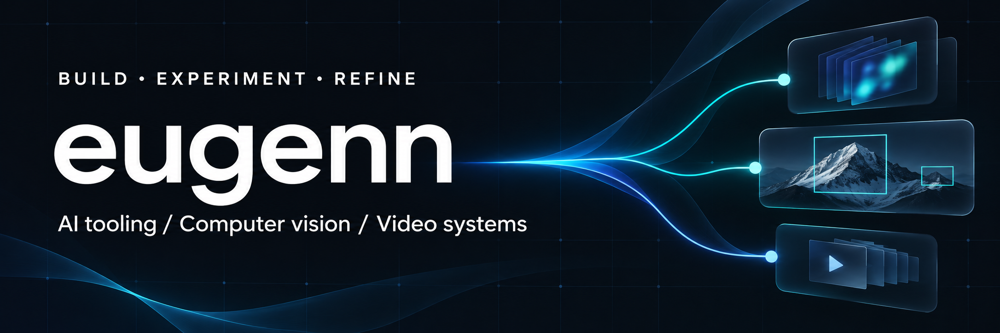

  

  I build tools for routing AI requests, exploring computer vision, 
  and measuring video processing performance. Based in Vilnius.

  <a href="https://www.linkedin.com/in/eugen-nekhai/">LinkedIn</a> &nbsp; · &nbsp;
  <a href="https://github.com/eugenn?tab=repositories">Repositories</a> &nbsp; · &nbsp;
  <a href="https://github.com/eugenn/switchyard-desktop">Currently building: Switchyard Desktop</a>

 

## Toolbox

   &nbsp;
   &nbsp;
   &nbsp;
   &nbsp;
   &nbsp;
  

Python · PyTorch · TypeScript · React · Rust · Tauri

## In focus

### [Switchyard Desktop ↗](https://github.com/eugenn/switchyard-desktop)

**Route AI requests across models and providers.**

Visual routing, provider setup, and request insights in a desktop app built with Tauri, React, and Rust.

`Development preview` &nbsp; `AI tooling` &nbsp; `Desktop`

Built on NVIDIA Switchyard through an independently maintained core fork.

## Selected projects

<table>
<tr>
<td width="50%" valign="top">

### [Agent Framework Comparison ↗](https://github.com/eugenn/nooa-demo)

One multi-agent pipeline, four implementations: NOOA, Microsoft Agent Framework, LangChain, and CrewAI.

`Python` · `AI agents`

</td>
<td width="50%" valign="top">

### [Switchyard Core ↗](https://github.com/eugenn/Switchyard)

My independently maintained fork of NVIDIA Switchyard, powering model routing in Switchyard Desktop.

`Rust` · `Model routing` · `Fork`

</td>
</tr>
<tr>
<td width="50%" valign="top">

### [Geolocation Simulator ↗](https://github.com/eugenn/geolocate-detections-simulator)

A browser-based lab for exploring the geolocation of detections.

`JavaScript` · `Simulation`

</td>
<td width="50%" valign="top">

### [Video Decoding Benchmark ↗](https://github.com/eugenn/video-decoders-benchmark)

Comparing GPU video decoding with torchcodec, decord, PyAV, and PyNvVideoCodec.

`Python` · `GPU video`

</td>
</tr>
</table>

## Open-source contributions

**[TorchCodec ↗](https://github.com/meta-pytorch/torchcodec)**  
Contributed a [merged fix for frame indexing](https://github.com/meta-pytorch/torchcodec/pull/1209) in videos with a non-zero start time when using approximate seeking.

---

Technology icons by <a href="https://github.com/tandpfun/skill-icons">Skill Icons</a>, used under the <a href="assets/skill-icons-LICENSE">MIT license</a>.
