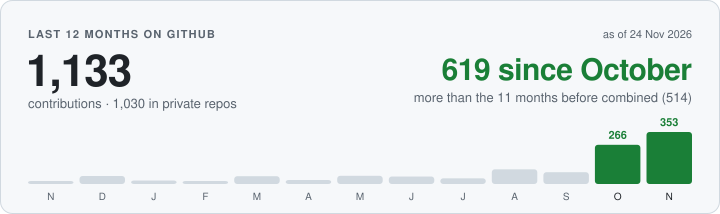
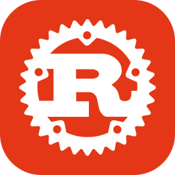

# eugenn

  I build tools for routing AI requests, exploring computer vision, 
  and measuring video processing performance. Based in Vilnius.

  <a href="https://www.linkedin.com/in/eugen-nekhai/">LinkedIn</a> &nbsp; · &nbsp;
  <a href="https://github.com/eugenn?tab=repositories">Repositories</a> &nbsp; · &nbsp;
  <a href="https://github.com/eugenn/switchyard-desktop">Currently building: Switchyard Desktop</a>

  <picture>
    <source media="(prefers-color-scheme: dark)" srcset="assets/activity-dark.svg">
    
  </picture>

  MERGED UPSTREAM 
  <a href="https://github.com/NVIDIA-NeMo/Switchyard/pulls?q=is%3Apr+author%3Aeugenn+is%3Amerged">NVIDIA Switchyard</a> ×3 &nbsp;·&nbsp;
  <a href="https://github.com/meta-pytorch/torchcodec/pull/1209">Meta TorchCodec</a> &nbsp;·&nbsp;
  <a href="https://github.com/junhoyeo/tokscale/pull/545">tokscale</a>

 

## Toolbox

   &nbsp;
   &nbsp;
   &nbsp;
   &nbsp;
   &nbsp;
  

Python · PyTorch · TypeScript · React · Rust · Tauri

## In focus

### [Switchyard Desktop ↗](https://github.com/eugenn/switchyard-desktop)

**Route AI requests across models and providers.**

Visual routing, provider setup, and request insights in a desktop app built with Tauri, React, and Rust.

`Development preview` &nbsp; `AI tooling` &nbsp; `Desktop`

Built on NVIDIA Switchyard through an independently maintained core fork.

## Products

<table>
<tr>
<td width="50%" valign="top">

### [TokStats ↗](https://tokstats.ai)

Analytics for your AI footprint: token usage and cost across coding agents, on your phone. Mobile companion for [tokscale](https://github.com/junhoyeo/tokscale).

`iOS` · `Android` · `AI usage`

</td>
<td width="50%" valign="top">

### Crashing Agents

A multiplayer card game where humans and AI agents play at the same table, with a daily rotating deck and an MCP server for agent players.

`TypeScript` · `Game` · `MCP` · `Private repo`

</td>
</tr>
</table>

## Selected projects

<table>
<tr>
<td width="50%" valign="top">

### [Agent Framework Comparison ↗](https://github.com/eugenn/nooa-demo)

One multi-agent pipeline, four implementations: NOOA, Microsoft Agent Framework, LangChain, and CrewAI.

`Python` · `AI agents`

</td>
<td width="50%" valign="top">

### [Switchyard Core ↗](https://github.com/eugenn/Switchyard)

My independently maintained fork of NVIDIA Switchyard, powering model routing in Switchyard Desktop.

`Rust` · `Model routing` · `Fork`

</td>
</tr>
<tr>
<td width="50%" valign="top">

### [Geolocation Simulator ↗](https://github.com/eugenn/geolocate-detections-simulator)

A browser-based lab for exploring the geolocation of detections.

`JavaScript` · `Simulation`

</td>
<td width="50%" valign="top">

### [Video Decoding Benchmark ↗](https://github.com/eugenn/video-decoders-benchmark)

Comparing GPU video decoding with torchcodec, decord, PyAV, and PyNvVideoCodec.

`Python` · `GPU video`

</td>
</tr>
<tr>
<td width="50%" valign="top">

### [Psybik ↗](https://github.com/eugenn/psybik)

A psychedelic 3×3 Rubik's cube for the browser: fractal or image faces, scramble, and an animated solve.

`Three.js` · `WebGL`

</td>
<td width="50%" valign="top">

### Sports computer vision

Physics-based synthetic 3D tennis ball trajectories (drag, Magnus effect, multi-camera views), padel court detection, and Airflow pipelines for tennis video.

`Python` · `Computer vision` · `Private repos`

</td>
</tr>
</table>

<b>Earlier work</b> · self-driving car and flying car projects (2017–2018)

 

**Self-driving car** · [Behavioral cloning](https://github.com/eugenn/CarND-Behavioral-Cloning-P3) · [Semantic segmentation](https://github.com/eugenn/CarND-Semantic-Segmentation) · [Traffic sign classifier](https://github.com/eugenn/CarND-Traffic-Sign-Classifier-Project) · [Vehicle detection](https://github.com/eugenn/CarND-Vehicle-Detection) · [Advanced lane lines](https://github.com/eugenn/CarND-Advanced-Lane-Lines) · [Extended Kalman filter](https://github.com/eugenn/CarND-Extended-Kalman-Filter-Project) · [Unscented Kalman filter](https://github.com/eugenn/CarND-Unscented-Kalman-Filter-Project) · [Particle filter](https://github.com/eugenn/CarND-Kidnapped-Vehicle-Project) · [PID control](https://github.com/eugenn/CarND-PID-Control-Project) · [Model predictive control](https://github.com/eugenn/CarND-MPC-Project) · [Path planning](https://github.com/eugenn/CarND-Path-Planning-Project)

**Flying car** · [3D estimation](https://github.com/eugenn/FCND-Estimation-CPP) · [Quadrotor control](https://github.com/eugenn/FCND-Controls-CPP) · [Motion planning](https://github.com/eugenn/FCND-Motion-Planning) · [Backyard flyer](https://github.com/eugenn/FCND-Backyard-Flyer)

## Open-source contributions

**[NVIDIA Switchyard ↗](https://github.com/NVIDIA-NeMo/Switchyard)**  
Contributed merged changes for [agent identity in routing logs](https://github.com/NVIDIA-NeMo/Switchyard/pull/1002), [task classifier history](https://github.com/NVIDIA-NeMo/Switchyard/pull/610), and [redacting upstream response bodies from tracing](https://github.com/NVIDIA-NeMo/Switchyard/pull/611).

**[TorchCodec ↗](https://github.com/meta-pytorch/torchcodec)**  
Contributed a [merged fix for frame indexing](https://github.com/meta-pytorch/torchcodec/pull/1209) in videos with a non-zero start time when using approximate seeking.

**[tokscale ↗](https://github.com/junhoyeo/tokscale)**  
Contributed a [merged `qr` command](https://github.com/junhoyeo/tokscale/pull/545) that transfers the API token to mobile apps, the link between tokscale and [TokStats](https://tokstats.ai).

---

Technology icons by <a href="https://github.com/tandpfun/skill-icons">Skill Icons</a>, used under the <a href="assets/skill-icons-LICENSE">MIT license</a>.
